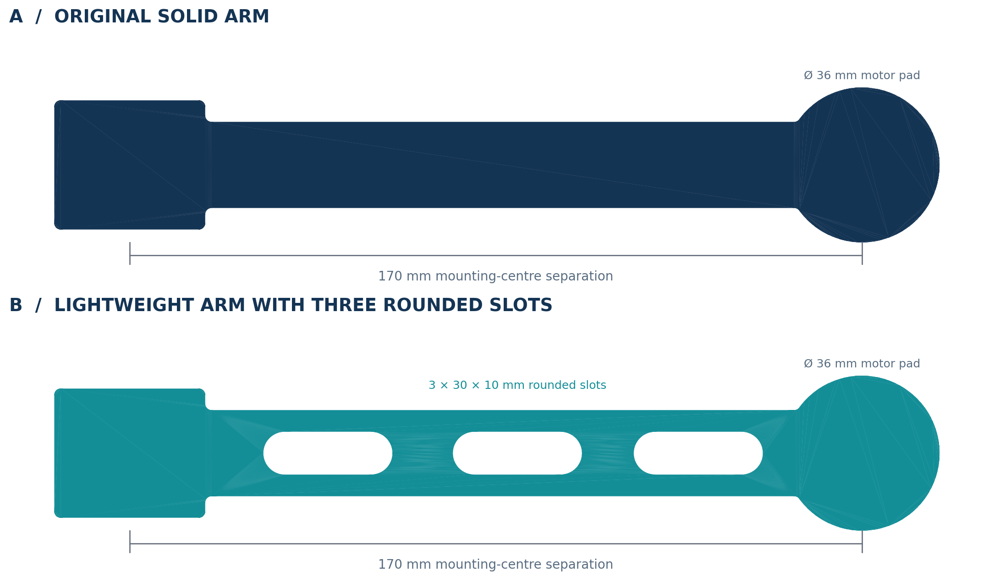
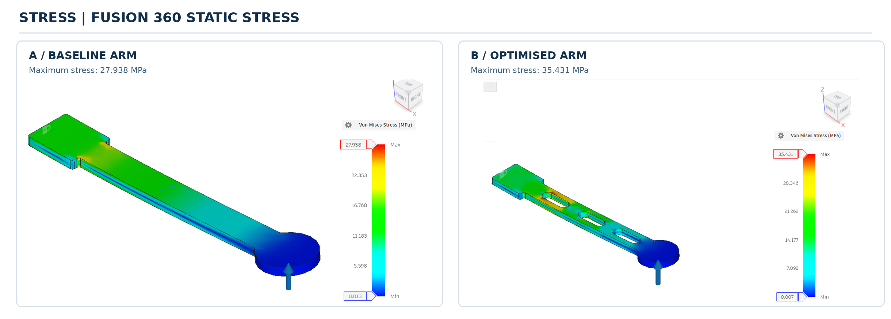
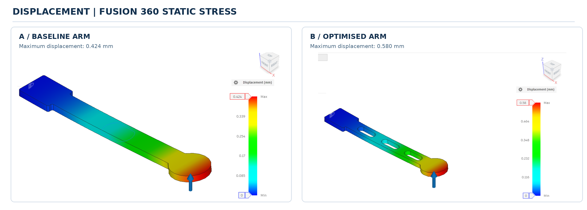

# Lightweight Quadcopter Arm — Structural Optimisation

**Autodesk Fusion 360 | CAD design and static finite element analysis | November 2026**

An aerospace engineering portfolio project comparing a baseline solid quadcopter arm with an optimised design featuring three rounded through-slots to reduce weight.



## Objective and results

**Design goal:** Reduce arm mass by at least **10%** while retaining a **minimum static safety factor of 2** and keeping **total deflection below 2 mm** under a **15 N upward motor load**.

| Metric | Baseline arm | Optimised arm | Comparison |
|---|---:|---:|---|
| Estimated mass | 77.38 g | 63.84 g | **17.49% lower** |
| Maximum von Mises stress | 27.938 MPa | 35.431 MPa | 26.8% higher |
| Minimum safety factor | 7.409 | 5.842 | Both above 2 |
| Maximum total displacement | 0.424 mm | 0.580 mm | Both below 2 mm |

**Outcome:** Under the simplified static loading conditions, the optimised arm meets the stated targets. Removing material reduces estimated mass but increases stress and deflection, illustrating the trade-off between structural weight and stiffness.

## Design and simulation setup

- **Geometry:** 170 mm nominal mounting-centre spacing; 20 mm beam width; 6 mm thickness; 36 mm-diameter motor mounting pad; 35 × 30 mm body mounting pad.
- **Optimisation:** Three rounded through-slots, approximately 30 × 10 mm each, with mounting pads retained.
- **Material:** Aluminum 6061 T6 0 Cold Formed, selected in Fusion 360.
- **Analysis:** Static Stress study with a fixed constraint on the vertical body-end face.
- **Loading:** 15 N applied in the global +Z direction at the motor pad, using a 14 mm-radius limited load region.
- **Comparison:** The same material, constraint approach, and loading method were used for both designs.

## Simulation comparisons

### Von Mises stress



### Total displacement



## Files in this repository

```text
Drone-Arm-Structural-Optimisation/
├── README.md
├── Baseline_Arm.step
├── Optimised_Arm.step
├── CAD_Comparison.png
├── Stress_Comparison.png
├── Displacement_Comparison.png
└── Engineering_Report.pdf
```

**To view the CAD models:** Upload the `.step` files through Autodesk Fusion 360's Data Panel. The STEP files contain solid geometry, but not the original parametric feature timeline. Native Fusion `.f3d` files can be exported separately from Fusion 360 and added to this repository if available.

Read the [three-page engineering report](Engineering_Report.pdf) for the full comparison and discussion.

## Limitations and next steps

This is a simplified comparative **static** structural study, not a flight-certified component assessment. The body connection was modelled as fixed, with no detailed bolted-joint representation. Motor torque, vibration, fatigue, lateral loads, contact effects, and physical testing were not assessed.

Future improvements include checking mass directly in Fusion 360, refining and checking mesh convergence, modelling realistic bolt connections and motor loads, and validating the simulation against physical tests.
